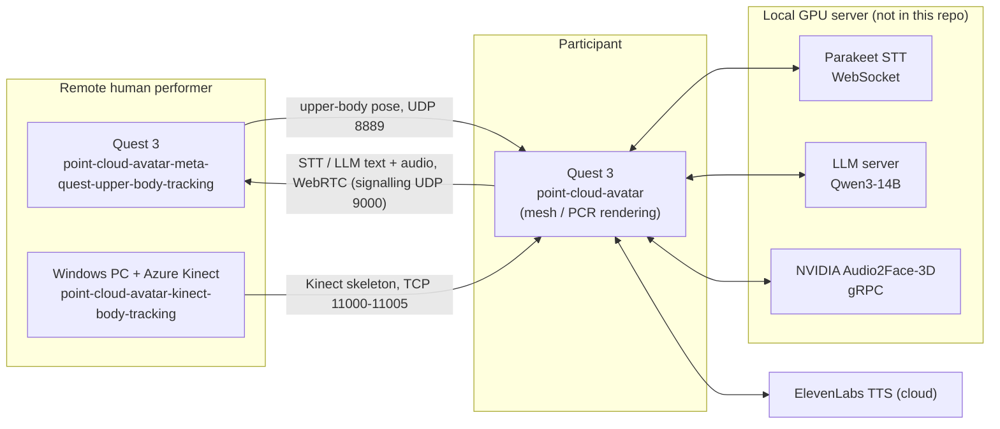

# PCR Virtual Character

Source code for the paper

> **The Impact of Point-Cloud Rendering on User Perceptions of Human- and AI-Controlled Avatar Embodiment**
> Tianyu Song, Baran Gürsoy, Felix Pabst, Ulrich Eck, Nassir Navab — Technical University of Munich
> IEEE ISMAR 2026

The paper studies how people perceive a virtual character that is shown either as a standard shaded mesh or as a simulated **point-cloud rendering (PCR)**, and that is either **teleoperated by a remote human** or **driven by AI**. We ran a 2 × 2 × 2 within-subjects study (rendering × control × scene) with 24 participants on Meta Quest 3. PCR improved perceived human-likeness and appearance–behavior plausibility, especially for the AI-driven character, and closed the human–AI plausibility gap in the high-movement scene.

This repository contains the real-time system used in the study. It consists of three Unity projects:

| Folder | Runs on | Role in the system |
|---|---|---|
| [`point-cloud-avatar/`](point-cloud-avatar/) | Participant's **Meta Quest 3** (Android) | Main app. Renders the character as mesh or PCR, runs the STT → LLM → TTS conversation loop with echo cancellation and Audio2Face lip sync, plays the AI animation library, and fuses the two tracking streams below in human-control mode. Also streams transcript, LLM reply and audio to the performer over WebRTC. |
| [`point-cloud-avatar-meta-quest-upper-body-tracking/`](point-cloud-avatar-meta-quest-upper-body-tracking/) | Performer's **Meta Quest 3** | Streams the performer's head, upper-body and finger pose (Meta Movement SDK) over UDP to the main app. Receives the conversation text and audio from the main app and shows it on a head-locked panel, so the silent performer can react. |
| [`point-cloud-avatar-kinect-body-tracking/`](point-cloud-avatar-kinect-body-tracking/) | Windows PC with an **Azure Kinect DK** | Runs Azure Kinect body tracking and serves the skeleton over TCP. The main app uses it for the performer's hips, legs, feet and root motion. |

Each folder is a self-contained Unity **6000.0.60f1** project with its own README. All three cover setup and configuration; the two tracking projects also document their network protocols and troubleshooting.

---

## How the pieces fit together



- **AI-driven condition:** only `point-cloud-avatar` and the servers are needed. The LLM picks clips from the bundled animation library.
- **Human-controlled condition:** all three projects run together. The Quest drives the head, arms and fingers. The Kinect drives the hips, legs and root motion. The performer stays silent, and the dialogue still comes from the same STT → LLM → TTS loop, so speech is identical across conditions.

| Link | Transport | Default port | Details |
|---|---|---|---|
| Performer Quest → main app | UDP, 876-byte pose packets | 8889 | [`point-cloud-avatar-meta-quest-upper-body-tracking/README.md` §2.1](point-cloud-avatar-meta-quest-upper-body-tracking/README.md#21-body-pose--udp-876-bytes) |
| Kinect PC → main app | TCP + UDP discovery | 11000–11005 | [`point-cloud-avatar-kinect-body-tracking/README.md` §2](point-cloud-avatar-kinect-body-tracking/README.md#2-network-interface) |
| Main app → performer Quest | WebRTC data channel + audio, UDP signalling | 9000 / 9001 | [`point-cloud-avatar-meta-quest-upper-body-tracking/README.md` §2.3](point-cloud-avatar-meta-quest-upper-body-tracking/README.md#23-stt--llm-text-and-audio--webrtc-with-udp-signalling) |
| Main app → STT server | WebSocket | 5092 | `ParakeetSTTHandler` |
| Main app → Audio2Face-3D | gRPC | 52000 (local) or NVIDIA cloud | `A2FClient` |

---

## What is *not* in this repository

To keep the repository publishable, the following are excluded. You need to provide them yourself:

1. **Paid Unity Asset Store packages**:
   - *Azure Kinect and Femto Bolt Examples for Unity* (RF Solutions), used by `point-cloud-avatar` and `point-cloud-avatar-kinect-body-tracking`.
   - *Final IK* (RootMotion), used by `point-cloud-avatar`.

   Both are git-ignored at their import locations. Each project README lists where to import them and which of their files we modified. We cannot publish the modified versions of the asset files. If you own licenses for the packages and need our changes, contact the authors.
2. **API keys.** Audio2Face-3D (NVIDIA NGC) and ElevenLabs keys must be entered locally and must not be committed. See [`point-cloud-avatar/README.md`](point-cloud-avatar/README.md).
3. **Server-side services:** the Parakeet STT WebSocket server (with Silero VAD), the LLM server and the Audio2Face-3D service.
4. **Package samples** (e.g. Meta Movement SDK samples). Re-import them from the Unity Package Manager if needed.
5. **Third-party files without a redistribution license**, such as the Kinect speckle pattern from SimKinect. The main project README says where to download it.

The CC-BY models that are included are credited in [`point-cloud-avatar/README.md`](point-cloud-avatar/README.md#third-party-content).

---

## Requirements at a glance

- Unity **6000.0.60f1** (Android Build Support for the two Quest projects).
- 2 × Meta Quest 3 / 3S: one for the participant, one for the performer (human-controlled mode only).
- Windows 10/11 PC with an NVIDIA GPU, Azure Kinect DK, Azure Kinect Sensor SDK 1.4.1 and Body Tracking SDK 1.1.2 (human-controlled mode only).
- A GPU server for STT / LLM / Audio2Face-3D. The study used an NVIDIA RTX 6000 Pro Blackwell.
- All devices on one local network. UDP broadcast is used for discovery.

---

## Citation

If you use this code, please cite:

```bibtex
@article{song2026pcr,
  title   = {The Impact of Point-Cloud Rendering on User Perceptions of Human- and AI-Controlled Avatar Embodiment},
  author  = {Song, Tianyu and G{\"u}rsoy, Baran and Pabst, Felix and Eck, Ulrich and Navab, Nassir},
  journal = {IEEE Transactions on Visualization and Computer Graphics},
  note    = {IEEE International Symposium on Mixed and Augmented Reality (ISMAR)},
  year    = {2026}
}
```

## Acknowledgments

This work was partly supported by the state of Bavaria through Bayerische Forschungsstiftung (BFS) under Grant AZ-1592-23-ForNeRo, and by the NVIDIA Academic Grant for Intelligent Virtual Agent for Robotic Ultrasound (IVARUS).
