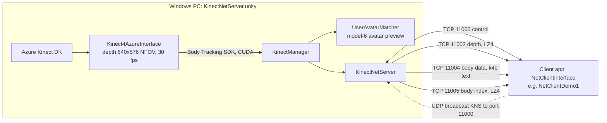

# K4A Body Tracking

A Windows desktop Unity app that runs **Azure Kinect (K4A) body tracking** on the PC the sensor is plugged into and streams the result (body data plus depth and body-index frames) over the network to client apps. It is the *KinectNetServer* demo scene of the paid Asset Store package **Azure Kinect and Femto Bolt Examples for Unity**, set up for body tracking. The network server has a thread-safety fix, and the preview avatar has a new mode that places its hips and legs at the tracked joint positions.

- Unity **6000.0.60f1**, product name *K4A Body Tracking*, Windows x64 standalone (the platform the asset's readme requires). The only build scene is `Assets/AzureKinectExamples/KinectDemos/NetworkDemo/KinectNetServer.unity`.
- The project has **no scripts of its own**. All code is in the asset (`Assets/AzureKinectExamples/`, v1.21 according to its What's New PDF). The project-specific work is edits to three asset scripts, the scene settings and the `model-6` avatar ([section 6](#6-changes-to-the-stock-asset)).
- Part of the [PCR Virtual Character](../README.md) system. The client is the main app in [`../point-cloud-avatar/`](../point-cloud-avatar/), which uses the Kinect skeleton for the performer's hips, legs and root motion.
- It serves **depth, body data and body index** on TCP **11000–11005**, with UDP server discovery on **11000**. Any app that uses the asset's `NetClientInterface` can connect, for example the stock `NetClientDemo1` scene.
- **The asset is not included in this repository.** It is a paid package that may not be redistributed, and `Assets/AzureKinectExamples/` is git-ignored. Import it yourself, then re-apply the changes in [section 4](#4-configuration) and [section 6](#6-changes-to-the-stock-asset) ([section 3](#3-requirements--setup)).

---

## 1. How it works



1. **Sensor and body tracking.** `KinectManager` (GameObject `KinectController`) opens the `Kinect4AzureInterface` on its child object `Kinect4Azure`. It requests depth, body and body-index frames; color is turned off. When body tracking starts, the interface copies the Body Tracking SDK runtime DLLs and `dnn_model_2_0_op11.onnx` from `C:/Program Files/Azure Kinect Body Tracking SDK/tools` into the working directory. In the Editor that is the project root, and these files are git-ignored.
2. **Server start.** `KinectNetServer` (GameObject `KinectNetServer`) first builds the sensor's space tables, or loads them from `ST-*.bin` cache files in the working directory. That is why the screen shows a note that the first start can take a while. The server then opens one TCP listener per enabled stream on port `Base Listen Port + NetMessageType`, listening on all network interfaces, plus a UDP discovery responder. `ServerStatusText` shows `NetServer listens on <ip>:11000-11005` and `ConnStatusText` shows the connection count. The scroll view shows the server log.
3. **Streaming.** On every `Update()`, new frames go out on the streams that have clients connected. If any data-stream connection still has unsent messages, that update is skipped; each connection queues at most 10 messages. The server also sends a keep-alive on the control port every 2 s.
4. **Local preview.** For each tracked user, `UserAvatarMatcher` (GameObject `AvatarMatcher`) creates an instance of `Assets/model-6.prefab` named `User-<id>` and adds an `AvatarController` with `applyBonePositions = true`. `Main Camera` follows the sensor pose (`FollowSensorTransform`) and the avatar is placed relative to it. `KinectManager` draws the user-body image of sensor 0 on screen.

There are no keyboard controls. The window only shows status text, a scrollable server console and the avatar.

---

## 2. Network interface

### Ports (Base Listen Port = 11000)

| Port | Transport | Stream (`NetMessageType`) | Served in this scene | Payload |
|---|---|---|---|---|
| 11000 | TCP | Control | yes | client commands; replies with sensor data (JSON), space tables, keep-alive |
| 11000 | UDP | discovery | yes | see below |
| 11001 | TCP | Color | no, color frames are off | JPEG |
| 11002 | TCP | Depth | yes | 640×576 `ushort` depth (mm), LZ4 |
| 11003 | TCP | Infrared | no | JPEG |
| 11004 | TCP | BodyData | yes | tab-separated `k4b` text (format below) |
| 11005 | TCP | BodyIndex | yes | 640×576 `byte` body index, LZ4 |
| 11006 | TCP | Pose | no | JSON |
| 11007–11010 | TCP | Depth2Color, Color2Depth, Color2BodyIndex, Color2Infrared | no, these need color and depth | transformed images / frames |

- The frame settings of `KinectManager` decide which streams exist ([section 4](#4-configuration)). Turning color frames back on also opens 11001 and 11007–11010.
- **Discovery:** a client broadcasts the UTF-8 string `KNS` to UDP port 11000. The server replies with `KNS|<server IP>|<base port>|<sensor type>|<sensor id>`.
- **One connection per client IP per port.** A new connection from an IP that is already connected closes the old one (`TcpNetServer.CloseConnectionsTo`).

### Connecting a client

- **Unity with the asset:** put a `NetClientInterface` on a child of the `KinectController` object, as in `NetClientDemo1`, and set:
  - *Auto Server Discovery*: UDP broadcast, same subnet only. It waits 5 s for a reply, then falls back to *Server Host*.
  - *Server Host*
  - *Server Base Port* = 11000

  The client only opens the streams that its own `KinectManager` requests. `NetClientDemo1` requests body data only (*Get Body Frames* = `BodyDataOnly`), so it uses TCP 11000 and 11004.
- **Custom client:** the data ports need no handshake. Connect to TCP 11004, for example, and read messages. The format is defined in `Assets/AzureKinectExamples/KinectScripts/KinectNetTools.cs` (`NetMessageData.WrapMessage`):

```text
int32  length      // number of bytes that follow = 14-byte header + payload
byte   msgType     // NetMessageType: 0 Control, 1 Color, 2 Depth, 3 Infrared, 4 BodyData, 5 BodyIndex, 6 Pose, ...
byte   encType     // FrameEncodeType: 1 Raw, 2 Jpeg, 3 K4b, 4 Json, 5 SensorDataJson, 6 DSTraw, 7 CSTraw, 8 Compressed
uint16 width
uint16 height
uint64 timestamp
byte[] payload     // if encType == 8: [byte original encType][int32 original length][LZ4Sharp-compressed data]
```

The integers are written with `System.BitConverter`, which is little-endian on Windows x64. Clients send control commands as uncompressed 1-byte payloads of `ControlMessageType`: `0` GetSensorData, `1` KeepAlive, `2` Disconnect, `3` GetDST, `4` GetCST.

The body-data payload comes from `KinectInterop.GetBodyFrameAsCsv`. All fields are separated by tabs:

```text
k4b  <timestamp>  <bodyCount>  <jointCount>  <scaleX>  <scaleY>  <scaleZ>
then for each body:   <isTracked 0|1>  [ <trackingId>  then for each joint: <trackingState>  [ <posX> <posY> <posZ> <rotX> <rotY> <rotZ> ] ]
```

- There are 32 joints, in `KinectInterop.JointType` order (`Pelvis` = 0 … `ThumbRight` = 31). `trackingState` is 0 NotTracked (no values follow), 1 Inferred or 2 Tracked.
- Positions are the joint positions in sensor space, in meters (`kinectPos`). Rotations are the joint orientations (`normalRotation`) as Euler angles in degrees. Numbers have 3 decimals and use the invariant culture. For Azure Kinect the space scale is `-1 -1 1`.

---

## 3. Requirements & setup

### Requirements

- Windows x64 PC with an **Azure Kinect DK**. The asset readme also describes Orbbec Femto Bolt/Mega, which work through Orbbec's K4A wrapper.
- **Azure Kinect Sensor SDK v1.4.1** and **Azure Kinect Body Tracking SDK v1.1.2**, the versions named in `Assets/AzureKinectExamples/_Readme/Readme-Azure-Kinect-Examples.pdf`. Install the Body Tracking SDK in its default location, because `Kinect4AzureInterface.BODY_TRACKING_TOOLS_FOLDER` is hard-coded to `C:/Program Files/Azure Kinect Body Tracking SDK/tools`.
- An NVIDIA GPU for the CUDA processing mode the scene uses. For other GPUs, see [section 4](#4-configuration).
- Unity 6000.0.60f1.
- A licensed copy of the asset (*Azure Kinect and Femto Bolt Examples for Unity*, v1.21).

### Getting started

1. Install both SDKs. Check the sensor in *Azure Kinect Viewer* and body tracking in *Azure Kinect Body Tracking Viewer*.
2. Clone this repo, open it in Unity 6000.0.60f1 and import the full asset from the Package Manager (*My Assets*) into `Assets/AzureKinectExamples/`. We used v1.21; if the store version is different, watch for compile errors.
3. Apply the script changes from [section 6](#6-changes-to-the-stock-asset). Then open `Assets/AzureKinectExamples/KinectDemos/NetworkDemo/KinectNetServer.unity` and set the values from [section 4](#4-configuration). On `AvatarMatcher`, set *Avatar Model* to `Assets/model-6.prefab`. The build list already points to this scene.
4. Press Play. The first start is slower because the space tables are being cached. The status line then shows the listening ports, and once you are tracked the `model-6` avatar follows you.
5. To test with a client, open `NetClientDemo1.unity` in another copy of the project or on another PC. Allow the Unity Editor (or the built player) through Windows Firewall for TCP 11000–11005 and UDP 11000.
6. To build, go to *File → Build Profiles → Windows* and use the Intel 64-bit architecture. The scene list already contains only the server scene. The asset readme also asks for Direct3D11 as the first Windows graphics API; this project has no explicit Windows API list. The player starts as a fullscreen window and has *Run In Background* enabled, so streaming continues when the window loses focus. The PC that runs the build needs the same SDK installation.

---

## 4. Configuration

All values are serialized in `KinectNetServer.unity`. Each heading names the GameObject, then the component. "Stock" is the value in the asset's original scene, shown only where this project changed it.

### `KinectNetServer` → `KinectNetServer`

| Inspector field | Value | Meaning |
|---|---|---|
| Sensor Index | 0 | sensor whose data is served |
| Base Listen Port | 11000 | each stream's port = base + `NetMessageType`; also the UDP discovery port |
| Listen For Server Discovery | on | answers `KNS` broadcasts |
| Compress Raw Frames | on | LZ4 for depth, body index and control data |
| Conn Status Text / Server Status Text / Console Text | `ConnStatusText` / `ServerStatusText` / `ConsoleContent` | UI output |

### `KinectController` → `KinectManager`

| Inspector field | Value (stock) | Effect |
|---|---|---|
| Get Depth Frames | `RawDepthData` | depth stream (11002) |
| Get Color Frames | `None` (stock `ColorTexture`) | no color stream and no color-aligned streams |
| Sync Depth And Color | off (stock on) | |
| Get Infrared Frames / Get Pose Frames | `None` | |
| Get Body Frames | `UserTexture` (stock `BodyAndBodyIndexData`) | body data and body index (11004/11005), plus the user-body texture shown on screen |
| Sync Body And Depth | on | |
| Max Tracked Users | 1 (stock 0 = unlimited) | the local `KinectManager` tracks one user, so the preview shows one avatar |
| Joint Position Smoothing / Joint Velocity Smoothing | `Default` / `Light` | |
| Bone Orientation Constraints | on | |
| Body Spin Filter | `FixBodySpinOnly` (stock `None`) | |
| Display Images | `UserBodyImageS0` (stock empty) | user-body image of sensor 0, at 20 % of the screen width |

The stock scene also had disabled `KinectV2` and `RealSense` interface objects under `KinectController`. They were removed, so `Kinect4Azure` is the only sensor interface.

### `KinectController/Kinect4Azure` → `Kinect4AzureInterface` (all stock values)

| Inspector field | Value |
|---|---|
| Device Streaming Mode / Device Index | `ConnectedSensor` / 0 |
| Depth Camera Mode | `_640_x_576_30Fps_3_86mNfov` |
| Color Camera Mode | `_1920_x_1080_30Fps` (unused while color is off) |
| Camera FPS | `_30_FPS` |
| Device Sync Mode | `Standalone` |
| Body Tracking Processing Mode | `K4ABT_TRACKER_PROCESSING_MODE_GPU_CUDA`. Without an NVIDIA GPU, switch to the `..._GPU_DIRECTML` or `..._CPU` mode. |
| Body Tracking Sensor Orientation | `K4ABT_SENSOR_ORIENTATION_DEFAULT` |
| Body Temporal Smoothing | 0 |
| Detect Floor For Pose Estimation | on |
| Transform position | (0, 1, 0) |

### `AvatarMatcher` → `UserAvatarMatcher`

| Inspector field | Value (stock) |
|---|---|
| Avatar Model | `Assets/model-6.prefab` (stock `U_Character_REF`) |
| Smooth Factor | 5 (stock 10) |
| Pos Relative To Camera | `Main Camera`, which has `FollowSensorTransform` with Reference Pose `DepthCameraPose` |
| Mirrored / Vertical / Horizontal Movement | on / on / on |
| Grounded Feet | off (stock on) |
| Apply Muscle Limits | off (stock on) |

The `AvatarController` added to each avatar always gets `applyBonePositions = true`; there is no Inspector field for it ([section 6](#6-changes-to-the-stock-asset)). To compare the avatar's legs with the raw joints, enter Play mode and turn on **Visualize Joints** on the `AvatarController` of the spawned `User-<id>` object. This shows a cyan cube at each tracked joint.

**Player settings:** *Active Input Handling* is *Both*, because the scene's EventSystem uses the legacy `StandaloneInputModule`. *Run In Background* is on.

---

## 5. Scenes

| Scene | In build | Purpose |
|---|---|---|
| `Assets/AzureKinectExamples/KinectDemos/NetworkDemo/KinectNetServer.unity` | yes (only scene) | the app described above |
| `Assets/AzureKinectExamples/KinectDemos/NetworkDemo/NetClientDemo1.unity` | no | stock client demo, useful for testing. `KinectController/NetClient` is set to discovery on, host `127.0.0.1`, port 11000. It requests body data only and uses the `U_Character_REF` avatar. |
| `Assets/Scenes/SampleScene.unity` | no | Unity template scene (camera + light), unused |

The other 43 scenes under `Assets/AzureKinectExamples/KinectDemos/` come with the asset and are not in the build.

---

## 6. Changes to the stock asset

The asset is not part of this repository. After importing it, apply these changes; we cannot redistribute the modified files.

| File | Change |
|---|---|
| `KinectScripts/KinectNetServer.cs` | In `TcpNetServer`, adding and removing connections and `Close()` are wrapped in `lock (connections)`, because the accept and client threads change the list. `MessageSentToClient` no longer logs `IOException`/`SocketException`, which happen normally when a client disconnects in the middle of a send; the connection is still closed. |
| `KinectScripts/AvatarController.cs` | New `applyBonePositions` option. When it is on, the avatar is updated in `LateUpdate()`, so it overrides the Animator. The hips, upper-leg, lower-leg and foot bones are moved to the tracked `Pelvis`, `Hip`, `Knee` and `Ankle` positions, and their rotations are applied without smoothing. New `visualizeJoints` option draws a 3 cm cyan cube (`JointCube_<joint>`) at each tracked joint. |
| `KinectDemos/AvatarDemo/Scripts/UserAvatarMatcher.cs` | Sets `applyBonePositions = true` on every `AvatarController` it adds. |
| `KinectDemos/NetworkDemo/KinectNetServer.unity` | Scene settings; stock values are listed in [section 4](#4-configuration). |
| `Assets/model-6.glb`, `Assets/model-6 fbx.fbx`, `Assets/model-6.prefab` | New avatar. The prefab is a variant of the glb (imported with glTFast). The FBX is imported as Humanoid, and the prefab variant gives the glb's Animator the FBX's humanoid Avatar. |
| `Packages/manifest.json` | Added `com.unity.cloud.gltfast` 6.16.0. |
| `ProjectSettings/EditorBuildSettings.asset` | Server scene set as the only build scene. |
| `.gitignore` | Ignores the whole `Assets/AzureKinectExamples/` asset, the Body Tracking runtime DLLs and model, and the `ST-*.bin` space-table cache files. |

(Paths in the first four rows are relative to `Assets/AzureKinectExamples/`.)

Development history, from the original (private) repository:

| Commit | Date | Message | Contents |
|---|---|---|---|
| `f425928` | 2026-01-25 | *k4a fix network issues* | Unity 6 project with the full asset import. It already includes the `KinectNetServer.cs` fix and these scene changes: color frames and Sync Depth And Color off, Smooth Factor 5, Vertical Movement and Apply Muscle Limits off. |
| `b24b97d` | 2026-01-27 | *update k4a setting* | Removed the `KinectV2`/`RealSense` objects, set Max Tracked Users to 1 and turned Apply Muscle Limits on. The `ProjectSettings.asset` diff only adds empty Android icon slots. |
| `569089f` | 2026-02-25 | *fix leg problem* | Added `applyBonePositions`/`visualizeJoints`, the `model-6` avatar and glTFast. Scene: Avatar Model `model-6.prefab`; Vertical Movement on; Grounded Feet and Apply Muscle Limits off; Get Body Frames `UserTexture`; Body Spin Filter `FixBodySpinOnly`; Display Images `UserBodyImageS0`. Also set the build scene and extended `.gitignore`. |

---

## 7. Third-party dependencies

| Dependency | Where | Notes |
|---|---|---|
| Azure Kinect and Femto Bolt Examples for Unity (rfilkov) | `Assets/AzureKinectExamples/` | **Paid Asset Store package** ([store page](https://www.assetstore.unity3d.com/en/#!/content/149700), [docs](https://github.com/rfilkov/k4adocs/wiki)). Covered by the Asset Store EULA; licenses of the bundled SDKs are in `Assets/AzureKinectExamples/Third-Party-Notices.txt`. Its readme PDFs are in `_Readme/`. |
| LZ4Sharp | `Assets/AzureKinectExamples/KinectScripts/LZ4Sharp/LZ4Sharp.dll` | Frame compression; ships with the asset. |
| Azure Kinect Sensor SDK 1.4.1, Body Tracking SDK 1.1.2 | system install, plus the asset's `SDK/` folder | [Sensor SDK download](https://docs.microsoft.com/en-us/azure/Kinect-dk/sensor-sdk-download), [Body Tracking SDK download](https://docs.microsoft.com/en-us/azure/Kinect-dk/body-sdk-download) (links from the asset readme). |
| glTFast `com.unity.cloud.gltfast` 6.16.0 | `Packages/manifest.json` | Imports `model-6.glb`. |
| Other UPM packages | `Packages/manifest.json` | `com.unity.inputsystem` 1.14.2, `com.unity.ugui` 2.0.0, `com.unity.feature.development` 1.0.2, `com.unity.multiplayer.center` 1.0.0. No scoped registries or git packages. |

**Licensing note:** the asset readme (`_Readme/Readme-Azure-Kinect-Examples.pdf`) asks users not to share the `KinectDemos` folder in source form or in public repositories. For this reason, the asset (including the configured `KinectNetServer.unity` scene) is not included in this repository, and `Assets/AzureKinectExamples/` is git-ignored so that a local import is never committed.

---

## 8. Related repositories

- [`../point-cloud-avatar/`](../point-cloud-avatar/) is the client: its `NetClientInterface` connects to this server, and the Kinect skeleton drives the character's lower body and root motion.
- [`../point-cloud-avatar-meta-quest-upper-body-tracking/`](../point-cloud-avatar-meta-quest-upper-body-tracking/) contains the same avatar files (`model-6.glb` and `model-6 fbx.fbx`, byte-identical). Its body streaming (`BodyDataReceiver`, UDP, default port 5001) uses its own protocol, not this server's.

---

## 9. Troubleshooting & notes

1. **Compile errors about `Microsoft.Azure.Kinect.Sensor`, `Intel.RealSense` or `Windows.Kinect`:** the asset (or its `SDK/` folder) is not imported. Import it as described in [section 3](#3-requirements--setup).
2. **`BT-Folder not found` warning, or body tracking doesn't start:** the Body Tracking SDK is not at `C:/Program Files/Azure Kinect Body Tracking SDK/tools`. Install it there or change `BODY_TRACKING_TOOLS_FOLDER` in `Kinect4AzureInterface.cs`. Without an NVIDIA GPU, also change *Body Tracking Processing Mode* on `Kinect4Azure`.
3. **Client can't find the server:** discovery is a UDP broadcast, so it only works within one subnet. The reply also contains the first non-link-local IPv4 address the server finds (`GetLocalNameOrIP()`), which can belong to the wrong adapter on PCs with several network cards. Turn off *Auto Server Discovery* on the client and set *Server Host* by hand. Also check the firewall (TCP 11000–11005, UDP 11000).
4. **Client gets no color or aligned images:** *Get Color Frames* is `None` on the server.
5. **Two clients on the same PC:** each port keeps only one connection per client IP, so the second client's connection closes the first one's.
6. **`Error updating NetServer: …` in the log:** the new lock only covers adding and removing connections. The main-thread loops over the connection list (`SendMessageToAllConnections`, `IsActive`, `GetMessageCount`) are not locked, so a client connecting or disconnecting during a loop can still throw. The exception is caught and logged.
7. **The leg change affects other scenes too:** `UserAvatarMatcher` always enables `applyBonePositions`, so it also applies in `NetClientDemo1`, `KinectAvatarsDemo4`, `BodyDataRecorderDemo` and `PlayerDetectorDemo`.
8. **Space-table cache files:** the server writes `ST-*.bin` files to the working directory. They are git-ignored, and you can delete them to force a rebuild.
