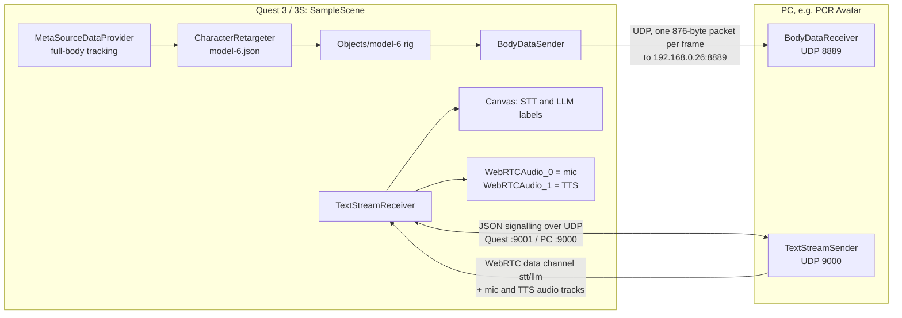

# Meta Quest Hand Tracking Streaming

A Unity app for **Meta Quest 3 / 3S** that streams the wearer's tracked **body pose** (retargeted onto an avatar rig) to a PC as raw UDP packets and, in the other direction, receives the **speech-to-text transcript, LLM reply and audio** of a PC-side avatar session over **WebRTC**, showing the text on a head-locked panel over passthrough. Despite the repository name, the shipped scene streams full-body pose; the hand-pose sender/receiver scripts are included but not placed in the scene.

- Unity **6000.0.60f1** (Built-in Render Pipeline, OpenXR), **Meta XR Interaction SDK 83.0.1** (`com.meta.xr.sdk.interaction.ovr`, pulls in Core SDK 83.0.1), **Meta XR Movement SDK** (git package; the scene was built with 83.0.0), **Unity WebRTC 3.0.0**, Newtonsoft Json 3.2.2, glTFast 6.16.0 — see [Packages/manifest.json](Packages/manifest.json).
- Android build: IL2CPP, ARM64, Vulkan, min/target API 32, product name *Meta Quest Hand Tracking*. Target devices Quest 3 and Quest 3S; hand tracking only (no controllers), body tracking **required**, passthrough supported.
- One scene: [Assets/Scenes/SampleScene.unity](Assets/Scenes/SampleScene.unity). The counterpart, which the code calls *PCR Avatar*, is the main app in [`../point-cloud-avatar/`](../point-cloud-avatar/) (see [section 8](#8-related-repositories)). Part of the [PCR Virtual Character](../README.md) system.

---

## 1. How it works



1. **Body tracking → avatar.** `Objects/model-6` is a Meta *Character Retargeter* building block: `MetaSourceDataProvider` (full-body joint set) feeds `CharacterRetargeter`, which poses the `model-6.glb` rig using the retargeting config [Assets/model-6.json](Assets/model-6.json).
2. **Avatar → UDP.** Every `Update()`, `BodyDataSender` on **Script Manager** reads the `Hips` local position/rotation plus the local rotations of 53 bone slots and sends one 876-byte datagram to `192.168.0.26:8889`.
3. **Discovery.** `TextStreamReceiver` (also on **Script Manager**) broadcasts a JSON `DISCOVER` to UDP port 9000 every 2 s until a sender's WebRTC `OFFER` leads to a connected session.
4. **Session.** The receiver answers; ICE candidates and 1 s heartbeats use the same UDP sockets.
5. **Text + audio.** `stt` / `llm` messages on the sender's data channel replace the text of the **STT** and **LLM** labels on the head-locked **Canvas**; the first remote audio track (voice/microphone) and the second (TTS) play on 2D AudioSources.

---

## 2. Wire protocols

All pose values are `float32` written with `BitConverter` (native byte order, i.e. little-endian on Quest and x86-64 PCs). Pose packets have no magic/version header, sequence number, timestamp or checksum; receivers simply apply the newest packet.

### 2.1 Body pose — UDP, 876 bytes

| Offset | Size | Content |
|---|---|---|
| 0 | 12 | root `localPosition` x, y, z |
| 12 | 16 | root `localRotation` x, y, z, w |
| 28 | 848 | 53 × bone `localRotation` x, y, z, w, in `StreamBodyJointId` order |

`StreamBodyJointId` ([Assets/Scripts/BodyTrackingNetworkStats.cs](Assets/Scripts/BodyTrackingNetworkStats.cs), also `DefaultPort = 5001`, `PacketSize = 876`). The names are what *Auto Map Bones (Full Skeleton)* searches for (case-insensitive substring):

| Index | Joints |
|---|---|
| 0–6 | Hips, Spine, Spine1, Spine2, Chest, Neck, Head |
| 7–10 | LeftShoulder, LeftArm, LeftForeArm, LeftHand |
| 11–14 | RightShoulder, RightArm, RightForeArm, RightHand |
| 15–18 | LeftUpLeg, LeftLeg, LeftFoot, LeftToeBase |
| 19–22 | RightUpLeg, RightLeg, RightFoot, RightToeBase |
| 23–37 | LeftHandThumb1–3, LeftHandIndex1–3, LeftHandMiddle1–3, LeftHandRing1–3, LeftHandPinky1–3 |
| 38–52 | RightHandThumb1–3, RightHandIndex1–3, RightHandMiddle1–3, RightHandRing1–3, RightHandPinky1–3 |

- **Sender (in scene):** `Avatar Root` is `model-6`'s **Hips**; every slot maps to the identically named `model-6` bone except **Chest (4)**, which the model does not have and is sent as identity. Local Unity frames are sent as-is (no axis conversion), one packet per frame whenever `Avatar Root` is set — including when body tracking is lost.
- **Receiver (`BodyDataReceiver`, not in scene):** listens on **Port** (default `5001`, so set it to `8889` for this scene) on a background thread and accepts datagrams ≥ 876 bytes. On the main thread it sets `Avatar Root.localPosition`, `Avatar Root.localRotation = rotation × Euler(Root Rotation Offset)` and each `Avatar Bones[i].localRotation` (each step behind its *Apply …* toggle). Rotations are copied verbatim, so the receiving rig needs the same bone names and rest orientations (e.g. the same `model-6` model). If `Avatar Root` is also `Avatar Bones[0]` (as on the sender), the bone pass overwrites the root rotation and *Root Rotation Offset* has no effect. After *Connection Timeout* (2 s) without packets it counts as disconnected (debug joints hidden).

### 2.2 Hand pose — UDP, 445 bytes (scripts only, not in scene)

`HandDataSender` sends one packet per hand per frame, only while that hand's `IHand.IsTrackedDataValid` is true:

| Offset | Size | Content |
|---|---|---|
| 0 | 1 | handedness: `0` = left, `1` = right |
| 1 | 12 | root (wrist) position x, y, z from `IHand.GetRootPose` (zeros if unavailable) |
| 13 | 16 | root rotation x, y, z, w (identity if unavailable) |
| 29 | 416 | 26 × joint rotation x, y, z, w from `IHand.GetJointPoseLocal` (identity if unavailable) |

Joint indices are the Interaction SDK `HandJointId` values, which in SDK 83 follow the OpenXR 26-joint layout (the sender also logs this mapping at startup):

| Index | Joint |
|---|---|
| 0, 1 | HandPalm, HandWristRoot |
| 2–5 | HandThumb1, HandThumb2, HandThumb3, HandThumbTip |
| 6–10 | HandIndex0, HandIndex1, HandIndex2, HandIndex3, HandIndexTip |
| 11–15 | HandMiddle0 … HandMiddle3, HandMiddleTip |
| 16–20 | HandRing0 … HandRing3, HandRingTip |
| 21–25 | HandPinky0 … HandPinky3, HandPinkyTip |

- **Fix Coordinate System** (default on) conjugates the root rotation and every joint rotation with `R = Euler(-90, 0, 0)`: `q' = R · q · R⁻¹` (tooltip: OpenXR Z-forward/Y-up → avatar Y-forward/Z-down). Positions are not converted.
- **`HandDataReceiver`** (default port `5005`, [Assets/Scripts/HandTrackingNetworkStats.cs](Assets/Scripts/HandTrackingNetworkStats.cs)) accepts exactly 445-byte datagrams, sets `Left/Right Hand Root` world position and rotation, and writes `localRotation` to `Left/Right Hand Bones[i]` (skipping the root). *Auto Map Bones* puts the root in slot 1 and fills slots 2–4, 7–9, 12–14, 17–19, 22–24 from bones named `{Left|Right}HandThumb1–3`, `…Index1–3`, `…Middle1–3`, `…Ring1–3`, `…Pinky1–3`; palm, metacarpal and tip slots stay empty. After *Connection Timeout* (1 s) without packets a hand counts as disconnected and its debug joints are hidden.

### 2.3 STT / LLM text and audio — WebRTC with UDP signalling

There is no signalling server: [Assets/Scripts/TextStreamReceiver.cs](Assets/Scripts/TextStreamReceiver.cs) exchanges UTF-8 JSON datagrams directly with the sender.

| Socket / service | Value |
|---|---|
| Receiver (Quest) binds | `Signaling Port + 1` = **UDP 9001** |
| Sender (PC) listens | `Signaling Port` = **UDP 9000** |
| ICE | STUN `stun:stun.l.google.com:19302` (hard-coded in `GetRTCConfiguration()`); no TURN server, so headset and PC need direct UDP connectivity |

Every signalling datagram is one JSON object with the fields `type`, `sdp`, `candidate`, `sdpMid`, `sdpMLineIndex`, `senderIP`, `senderPort` (unused fields are `null`/`0`). On receipt, `senderPort` is replaced by the datagram's source port and an empty `senderIP` by its source address.

| `type` | Direction | Handling |
|---|---|---|
| `DISCOVER` | Quest → `255.255.255.255:9000` **and** `127.0.0.1:9000` (or only `Sender IP:9000` if set), every *Discovery Interval* (2 s) while not connected | carries the receiver's own LAN IP in `senderIP` |
| `OFFER` | PC → Quest `:9001` | receiver creates an `RTCPeerConnection`, applies the SDP, replies to `senderIP` at the datagram's source port |
| `ANSWER` | Quest → PC | answer SDP |
| `ICE` | both | trickled `candidate`, `sdpMid`, `sdpMLineIndex` |
| `HEARTBEAT` | both, every 1 s once ICE is connected | no heartbeat for *Heartbeat Timeout* (5 s), ICE `Disconnected`/`Failed` or data-channel close → peer connection disposed, `OnDisconnected`, discovery restarts |

Once connected:

- **Data channel** (created by the sender; any label is accepted) carries JSON messages:

  | Field | Type | Meaning |
  |---|---|---|
  | `type` | string | `stt` → replaces the text of **Stt Display Text** and fires `OnSTTReceived`; `llm` → **Llm Display Text** and `OnLLMReceived`; other values are ignored |
  | `text` | string | the full text to show |
  | `timestamp` | long | ignored by the receiver (PCR Avatar sends Unix time in ms) |

- **Audio tracks** are assigned by arrival order: 1st → **Voice Audio Source** (logged as "Voice (Mic)"), 2nd → **Tts Audio Source** ("TTS"). Both fields are empty in the scene, so the script creates looping 2D AudioSources `WebRTCAudio_0` / `WebRTCAudio_1` under **Script Manager** and attaches an `AudioStreamDebugger` to each.

---

## 3. Requirements

- **Headset:** Meta Quest 3 or Quest 3S (the target devices in [Assets/Oculus/OculusProjectConfig.asset](Assets/Oculus/OculusProjectConfig.asset)) in developer mode.
- **Unity:** 6000.0.60f1 with Android Build Support; git on the PATH (the Movement SDK is a git UPM dependency).
- **PC side:** something that receives body packets on UDP 8889 and a `TextStreamSender`-compatible peer on UDP 9000 — the main app in [`../point-cloud-avatar/`](../point-cloud-avatar/) provides both.
- **Network:** headset and PC on the same subnet with UDP broadcast allowed (or set **Sender IP**), and direct UDP between them for WebRTC.
- Optional: Quest Link for Play-mode testing — the first commit is titled "streaming tested in link mode".

## 4. Getting started

1. Open the project with Unity **6000.0.60f1** and let the Package Manager resolve packages.
2. Open [Assets/Scenes/SampleScene.unity](Assets/Scenes/SampleScene.unity) (the only scene in the build list).
3. Select **Script Manager** and set:
   - **Body Data Sender → Target IP / Target Port** to the receiving PC (scene: `192.168.0.26` / `8889`).
   - **Text Stream Receiver → Sender IP**: leave empty for broadcast discovery or enter the PC's IP; keep **Signaling Port** equal to the sender's (`9000`).
4. Recommended: open **Project Settings → Meta XR** (Project Setup Tool) and apply the fixes it lists.
5. Run it:
   - **On Quest:** *File → Build Profiles* → Android → *Switch Platform*, then *Build And Run* with the headset connected (IL2CPP / ARM64 / Vulkan / API 32 are already configured).
   - **In the Editor:** enter Play mode with the headset on Quest Link. `TextStreamReceiver` has no XR dependency and also sends `DISCOVER` to `127.0.0.1`, so it can be tested against a sender on the same PC.
6. Start the PC side — PCR Avatar, or your own Unity scene with `BodyDataReceiver`: set **Port** to `8889`, assign **Avatar Root**, run *Auto Map Bones (Full Skeleton)* from the component's context menu. Allow inbound UDP 8889 and 9000 through the PC firewall.

## 5. Configuration reference

All values are serialized in `SampleScene.unity`; serialized values override the script defaults.

| GameObject → component | Inspector field | SampleScene | Script default |
|---|---|---|---|
| **Script Manager** → `BodyDataSender` | Target IP | `192.168.0.26` | `192.168.1.100` |
| | Target Port | `8889` | `5001` |
| | Avatar Root | `model-6` → `Hips` | — |
| | Avatar Bones | 53 slots, all `model-6` bones except Chest (empty) | — |
| **Script Manager** → `TextStreamReceiver` | Signaling Port | `9000` (binds `9001`) | `9000` |
| | Sender IP | empty → broadcast + `127.0.0.1` | empty |
| | Discovery Interval / Heartbeat Timeout | `2` s / `5` s | `2` / `5` |
| | Stt Display Text / Llm Display Text | `Canvas/STT` / `Canvas/LLM` | — |
| | Voice Audio Source / Tts Audio Source | none → created at runtime | — |
| not in scene: `HandDataSender` | Target IP / Target Port / Fix Coordinate System | — | `192.168.1.100` / `5005` / on |
| not in scene: `HandDataReceiver` | Port / Connection Timeout / Show Debug Visuals | — | `5005` / `1` s / on |
| not in scene: `BodyDataReceiver` | Port / Connection Timeout / Show Debug Visuals | — | `5001` / `2` s / off |

Project-level settings that matter for streaming:

- [Assets/Oculus/OculusProjectConfig.asset](Assets/Oculus/OculusProjectConfig.asset): target devices Quest 3 + Quest 3S; Hand Tracking Support *Hands Only*, frequency *High*, version *V2*; Body Tracking Support *Required*; Passthrough Support *Supported*.
- [Assets/Resources/OculusRuntimeSettings.asset](Assets/Resources/OculusRuntimeSettings.asset): body tracking fidelity *High*, joint set *Full Body*, OpenXR hand skeleton.
- `OVRManager` on `[BuildingBlock] Camera Rig`: passthrough enabled; all *Permission Requests On Startup* toggles off.
- Player Settings: scripting define `OVR_DISABLE_HAND_PINCH_BUTTON_MAPPING`; Active Input Handling *Both*. `Assets/XR/`: OpenXR loader (Android and Standalone) with the Meta XR feature.

## 6. In-headset UI and debug tools

- **Canvas** — world-space, child of `CenterEyeAnchor`, 4.71 m ahead at scale 0.005 (head-locked): **STT** (green) shows the latest transcript, **LLM** (white, below) the latest reply. A **Status** label exists but is inactive and not driven by any script.
- Also visible: passthrough (underlay) and the retargeted `Objects/model-6` avatar. `MirroredObjects/model-6` (inactive) is a `MirrorTransforms` copy at z = 1 m, rotated 180° and mirrored on X.
- No script in `Assets/Scripts` reads controller or gesture input; configuration happens in the Inspector.
- At runtime `TextStreamReceiver` shows **Is Connected** and **Connection Status** (`Discovering...`, `Connected`, `DataChannel Open`, `Disconnected`) in the Inspector. It exposes `IsConnected`, `ConnectionStatus` and the UnityEvents `OnConnected`, `OnDisconnected`, `OnSTTReceived`, `OnLLMReceived` (none wired in the scene). `SetTargetIP(string)` on both sender scripts changes the destination at runtime.

Inspector context-menu actions (Editor):

| Component | Menu item | Effect |
|---|---|---|
| `TextStreamReceiver` | Force Discovery | send one `DISCOVER` now |
| | Show Connection Status | log status, connection flag and data-channel state |
| | Start Debug Stats | log inbound audio RTP bytes/packets/lost every 2 s while connected |
| | Test Local Audio (ref.wav) | play `Assets/StreamingAssets/ref.wav` on a temporary AudioSource. The file is not included; add your own 16 kHz mono WAV to use this. |
| `AudioStreamDebugger` (added at runtime) | Start Recording / Stop and Save WAV | save received audio as 16-bit WAV to `Application.persistentDataPath`; also logs RMS/dB every second while audio is present |
| `BodyDataSender`, `BodyDataReceiver` | Auto Map Bones (Full Skeleton) | fill **Avatar Bones** by name below **Avatar Root** |
| `HandDataReceiver` | Auto Map Bones | fill the left/right bone lists by name |

## 7. Project structure

| Path | Purpose |
|---|---|
| [Assets/Scripts/BodyDataSender.cs](Assets/Scripts/BodyDataSender.cs) | Sends a rig's root pose + 53 bone rotations over UDP (**in scene**) |
| [Assets/Scripts/BodyDataReceiver.cs](Assets/Scripts/BodyDataReceiver.cs) | Applies body packets to a rig, optional debug joints |
| [Assets/Scripts/BodyTrackingNetworkStats.cs](Assets/Scripts/BodyTrackingNetworkStats.cs) | Body port/size constants, `BodyData`, `StreamBodyJointId` |
| [Assets/Scripts/HandDataSender.cs](Assets/Scripts/HandDataSender.cs) | Sends `IHand` wrist pose + 26 joint rotations per hand |
| [Assets/Scripts/HandDataReceiver.cs](Assets/Scripts/HandDataReceiver.cs) | Applies hand packets to left/right hand rigs, optional debug joints |
| [Assets/Scripts/HandTrackingNetworkStats.cs](Assets/Scripts/HandTrackingNetworkStats.cs) | Hand port/size constants, `Handedness`, `HandData` |
| [Assets/Scripts/TextStreamReceiver.cs](Assets/Scripts/TextStreamReceiver.cs) | UDP-signalled WebRTC receiver for STT/LLM text and audio; also defines `AudioStreamDebugger` (**in scene**) |
| [Assets/model-6.glb](Assets/model-6.glb), [Assets/model-6.json](Assets/model-6.json), [Assets/model-6-metadata.asset](Assets/model-6-metadata.asset) | Avatar used in the scene (glTFast import), its Movement SDK retargeting config and editor metadata |
| `Assets/model-6 fbx.fbx` (+ `.json`, `-metadata.asset`) | FBX variant of the avatar; not referenced by the scene |
| `Assets/Samples/` (not included, git-ignored) | Optional: re-import *Body Tracking Samples* from *Package Manager → Meta XR Movement SDK → Samples*. The scene does not use them. |
| `Assets/Oculus/`, `Assets/Resources/`, `Assets/XR/` | Meta XR project/runtime settings and OpenXR loader settings |

Scripts use the namespaces `HandTrackingStreaming` (hand scripts and `TextStreamReceiver`) and `BodyTrackingStreaming`. Scene hierarchy of `SampleScene`:

```text
Directional Light
[BuildingBlock] Camera Rig             OVRCameraRig, OVRManager, OVRHeadsetEmulator
  TrackingSpace/CenterEyeAnchor/Canvas   Status (inactive), STT, LLM
  [BuildingBlock] OVRInteractionComprehensive
[BuildingBlock] Passthrough            OVRPassthroughLayer
Objects/model-6                        MetaSourceDataProvider, CharacterRetargeter
MirroredObjects/model-6  (inactive)    MirrorTransforms
Script Manager                         BodyDataSender, TextStreamReceiver
EventSystem                            EventSystem, InputSystemUIInputModule
```

## 8. Related repositories

- **[`../point-cloud-avatar/`](../point-cloud-avatar/)** (*PCR Avatar*): the main app named in `TextStreamReceiver`'s doc comment. Its `Assets/Scripts/TextStreamSender.cs` is the matching peer: binds UDP **9000**, answers `DISCOVER` with an `OFFER`, opens a `textStream` data channel for `stt`/`llm` JSON and adds the microphone track before the TTS track. Its copy of `BodyDataReceiver` (`Assets/Scripts/Streaming/`) listens on **8889** (e.g. `Assets/Scenes/HumanControl.unity`).
- **[`../point-cloud-avatar-kinect-body-tracking/`](../point-cloud-avatar-kinect-body-tracking/)**: contains byte-identical `Assets/model-6.glb` and `Assets/model-6 fbx.fbx`; no shared network code.

## 9. Development history

From the original (private) repository:

| Date | Commit | Change |
|---|---|---|
| 2026-01-26 | `04412c6` streaming tested in link mode | Hand streaming (445-byte UDP); scene object *Hand Manager* sent to `192.168.0.26:8888` |
| 2026-01-27 | `99910ce` add body tracking streaming | Body streaming (876-byte UDP), Movement SDK + glTFast, `model-6` avatar; body tracking *Required*; the scene sender switched to `BodyDataSender` → `:8889` |
| 2026-02-02 | `ac72dbe` add webrtc | `com.unity.webrtc` 3.0.0, Canvas with Status/STT/LLM labels; two scene components referenced scripts that were never committed |
| 2026-02-03 | `24197ac` added STT, LLM text streaming | `TextStreamReceiver` (text only), Newtonsoft Json, Active Input Handling *Both* |
| 2026-02-03 | `592e63e` receive participant audio | Remote audio tracks → AudioSources, `AudioStreamDebugger`, `ref.wav` |
| 2026-02-04 | `c4105dd` move STT LLM canvas | Canvas to world space 4.71 m ahead, Status hidden, **Sender IP** `127.0.0.1` → empty (broadcast) |
| 2026-02-04 | `26e543d` comment out the log | `BodyDataSender` re-enabled in the scene, its periodic send log commented out |

## 10. Known issues and troubleshooting

- **Hand streaming is not wired up.** To use it, add `HandDataSender`, point **Left/Right Hand Source** at objects with an `IHand` component (the first commit used hand components inside `[BuildingBlock] OVRInteractionComprehensive`) and give the receiver the same port.
- **`HandDataReceiver` throws with default settings.** *Show Debug Visuals* defaults to on; without a *Debug Joint Prefab* the debug joints are never created, so once bones are assigned `ApplyHandData` hits a `NullReferenceException`. That aborts `Update`, so the right hand is not applied while left-hand data arrives. Assign a prefab or untick the option.
- **Movement SDK is unpinned.** The manifest uses the bare git URL and `Packages/packages-lock.json` is git-ignored, so a fresh clone fetches the current Unity-Movement default branch, which may differ from the 83.0.0 used for the committed scene. Append `#<tag-or-commit>` to pin it.
- **[.gitignore](.gitignore) hides Android folders.** The `[Aa]ndroid/` rule also matches `Assets/Plugins/Android/`, so a custom manifest or plugin there would not be committed; `com.*` ignores anything named `com.*`, e.g. embedded packages.
- **No authentication.** Pose datagrams and signalling are plain, unauthenticated UDP and any host on the subnet can answer the discovery broadcast — use a trusted network.

Checklist when something doesn't work:

1. **PC receives no body data** — check **Target IP / Target Port** on **Script Manager**, that the receiver's **Port** is `8889` (its default is `5001`) and the PC firewall. A `Received invalid packet size` warning means the formats are mixed up (hand = 445 bytes, body = 876).
2. **Avatar never moves in a build** — body tracking needs `com.oculus.permission.BODY_TRACKING`, and *Permission Requests On Startup → Body Tracking* is off on `OVRManager` (`[BuildingBlock] Camera Rig`) in this scene; enable it.
3. **Text panel stays "STT" / "LLM"** — *Connection Status* stuck at `Discovering...`: the sender isn't listening on `9000`, broadcast is blocked (set **Sender IP**), or UDP `9001` to the headset is filtered.
4. **Connected but silent** — check that `WebRTCAudio_0` / `WebRTCAudio_1` appear under **Script Manager** and `[AudioDebugger] … PLAYING` is logged; run *Start Debug Stats* after connecting (the call in `Start()` ends immediately because nothing is connected yet).
5. **Nothing leaves the headset at all** — Player Settings → *Internet Access* is *Auto* (`ForceInternetPermission: 0`); try *Require*.
